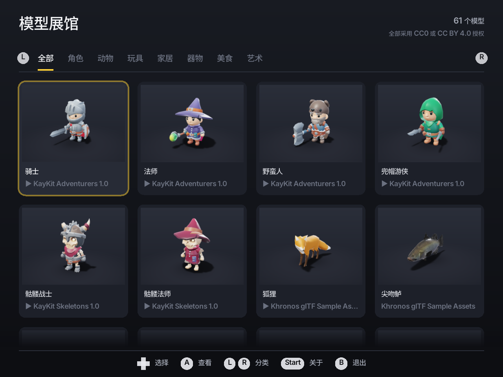
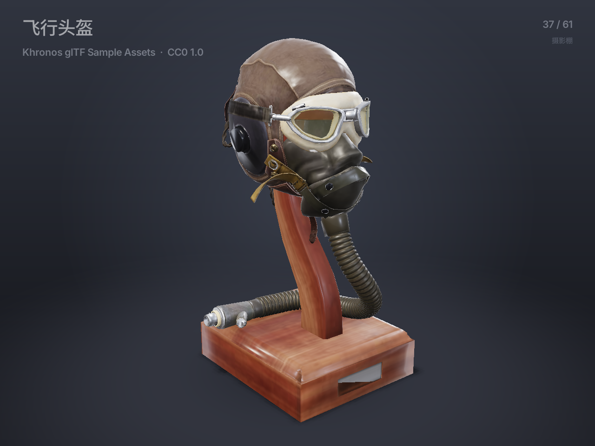
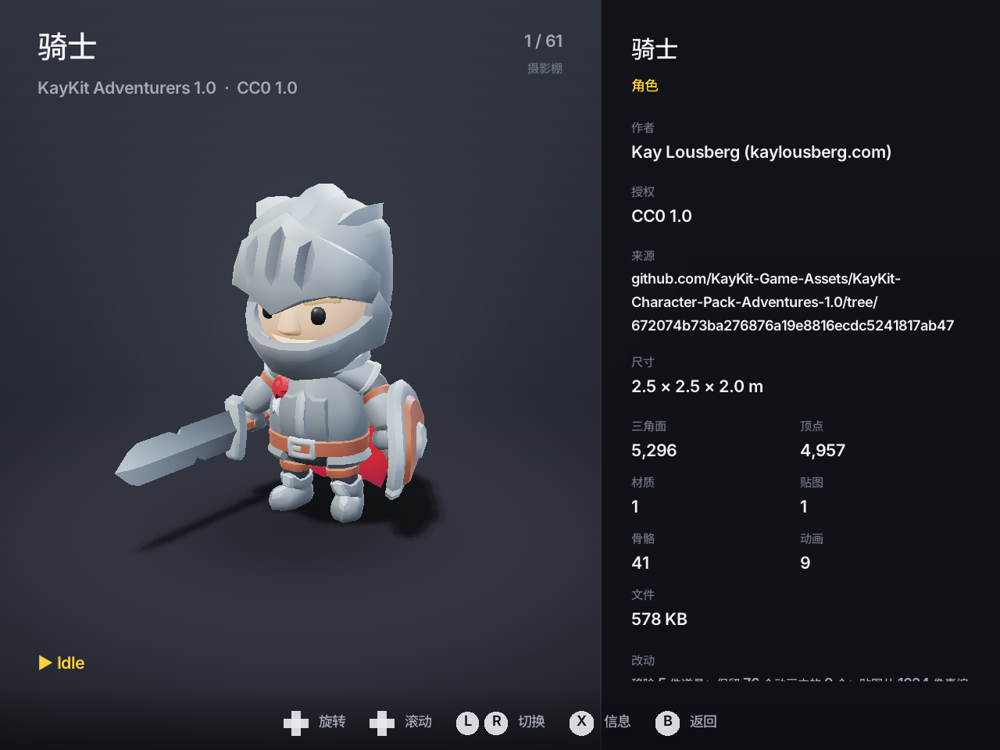
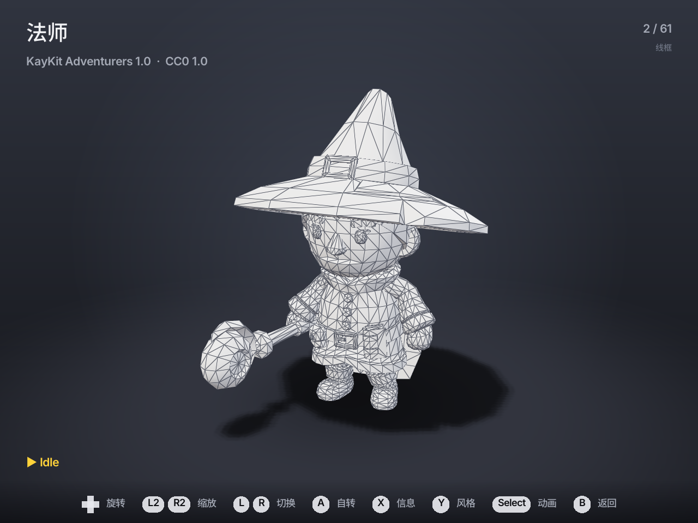

# Models Viewer · 模型展馆

A pocket gallery of open 3D models for [Gizlet OS](https://github.com/gizlet/os) handhelds such as the R36S, written in Rust with raylib. It shows 61 models from Khronos, Poly Haven, KayKit, Google Research and NVIDIA, all CC0 or CC BY 4.0. You can browse them by category, then turn, zoom and animate each one on a lit stage and see who made it.



| Flight Helmet | Knight, with its credits | Mage in wireframe |
| --- | --- | --- |
|  |  |  |

## What it does

| | |
| --- | --- |
| Gallery | Seven categories, from characters and animals to food and art. Every card shows a picture rendered by the app itself |
| Stage | A key, fill and rim light that follow the camera, a sky-to-floor ambient, a studio reflection, filmic tone mapping and the model's shadow on a floor that fades into the backdrop |
| Styles | Studio, clay, wireframe and normals |
| Animation | glTF skins and clips play on the GPU, with a short cross-fade between clips |
| Credits | Authors, license, source, size, triangles, vertices, materials, textures, joints, animations, file size and the changes made for the handheld, in Chinese and English |

## Models and licenses

Every model is CC0 1.0 or CC BY 4.0. [ASSETS.md](ASSETS.md) lists each one with its authors, source, license and the changes made for the handheld. The app shows the same credits on each model's information panel.

[`tools/models/sources.mjs`](tools/models/sources.mjs) lists the models with their pinned source revisions. [`tools/models/build.mjs`](tools/models/build.mjs) downloads them, checks each license at its source, and records the SHA-256 of every download in `sources.lock.json`. It then writes the handheld copies to `assets/models/`. Each copy is a single GLB with textures of at most 512 px; static meshes are simplified to 16,000 triangles, and unused props and animations are removed. It also writes the app's `catalog.json` and `ASSETS.md`.

```sh
cd tools/models
npm ci
npm run build                 # every model; `npm run build -- fox` for some
```

Then refresh the card pictures and fonts:

```sh
MODELSVIEWER_THUMBS=assets/thumbs cargo run --release
uv run tools/fonts/subset.py   # after changing strings or the catalog
```

## Run on a Mac or Linux desktop

Requirements: [rustup](https://rustup.rs) and CMake (raylib-sys builds raylib for the desktop).

```sh
./scripts/dev.sh run --release
```

| Keys | Button | Gallery | Viewer |
| --- | --- | --- | --- |
| Arrows or WASD | D-pad / stick | Choose | Turn and tilt |
| Enter, Space or K | A | View | Auto-rotate on or off |
| Backspace or J | B | Press twice to quit | Back |
| Q / E | L / R | Category | Previous or next model |
| Z / C, mouse wheel | L2 / R2 | | Zoom |
| I | X | | Information panel |
| U | Y | | Style |
| Tab | Select | | Next animation |
| Esc or P | Start | About | Reset the view |

The mouse turns the model when dragged. Hold Select and Start for 1.5 seconds to quit from anywhere.

| Variable | Effect |
| --- | --- |
| `GIZLET_LANG=en` | English (Simplified Chinese otherwise) |
| `GIZLET_SWAP_AB=1` | Swap A and B |
| `GIZLET_SAVE_DIR` | Where the style, auto-rotate and last model are kept (`./save` otherwise) |
| `MODELSVIEWER_WINDOW=WxH` | Desktop window size (960x720 by default) |
| `MODELSVIEWER_MSAA=0` | No 4× multisampling; without a multisampled display the app falls back on its own |
| `MODELSVIEWER_FPS=N` | Frame-rate cap while something moves (60); still frames are drawn at 20 |
| `MODELSVIEWER_TIMING=1` | Print how long each model takes to read |
| `MODELSVIEWER_PRESS=A@1,R1@2.5` | Press buttons at those seconds; with `MODELSVIEWER_SECONDS=N` and `MODELSVIEWER_HIDDEN=1` for scripted runs |
| `MODELSVIEWER_CAPTURE=FILE.png` | Render one frame and exit: `MODELSVIEWER_SCENE` is `gallery`, `viewer`, `info`, `about`, `cover` or `icon`, with `MODELSVIEWER_MODEL`, `MODELSVIEWER_TAB`, `MODELSVIEWER_STYLE`, `MODELSVIEWER_AT` and `MODELSVIEWER_SIZE` (1280x960) |

```sh
./scripts/dev.sh test
```

The tests load every bundled model and check its catalog entry, and check that the fonts draw every character the app can show. They also cover animation sampling, mesh splitting, controls and settings.

## Run on Gizlet OS

On the device the app links Gizlet runtime 1's `libraylib.so.600`, built for DRM with OpenGL ES 3.0, and reads the handheld's buttons from evdev. Install Python 3.11 or newer, [zig](https://ziglang.org) and the Rust `aarch64-unknown-linux-gnu` target, and build runtime 1's raylib in [gizlet/os](https://github.com/gizlet/os) with `bazel build --config=r36s //runtime:raylib`.

```sh
GIZLET_RAYLIB_LIB=/path/to/folder/with/libraylib.so ./scripts/dev.sh package
scp dist/io.gizlet.modelsviewer-0.1.0-aarch64-unknown-linux-gnu-lite.gzl root@DEVICE:/tmp/
ssh root@DEVICE 'gizlet install /tmp/io.gizlet.modelsviewer-0.1.0-aarch64-unknown-linux-gnu-lite.gzl'
```

The package is about 21 MB: the app is 1.8 MB, and the models and their pictures make up the rest. Models are read and decoded on a worker thread, so the interface keeps moving while one loads. Only one model is held in memory at a time.

To publish a release, update the version in `gizlet.toml` and merge to `main`. After the tests and the `.gzl` build pass, CI creates `v<version>`, publishes the GitHub Release and waits for the Gizlet Store checks.

## Layout

| Path | Holds |
| --- | --- |
| `gizlet.toml`, `store/` | The app manifest, Store text, icon, cover and screenshots |
| `src/main.rs` | The window, the frame loop and captures |
| `src/app.rs` | The gallery, viewer and about screens and their controls |
| `src/scene.rs` | Reading GLB files: meshes split for 16-bit indices, materials, images, nodes, skins and animations |
| `src/anim.rs` | Sampling clips, cross-fades, world and joint matrices |
| `src/gpu.rs` | Shaders, uploads, the stage, the shadow and the styles, over rlgl |
| `src/text.rs`, `src/ui.rs` | Strings in both languages, font atlases and drawing helpers |
| `src/input.rs`, `src/evdev.rs` | Keyboard, mouse, gamepads and the handheld's buttons |
| `src/catalog.rs`, `src/loader.rs`, `src/settings.rs` | The model catalog, background loading and saved settings |
| `assets/` | The handheld models, their card pictures and the subset fonts |
| `tools/models/`, `tools/fonts/` | The asset pipeline |
| `scripts/` | Development, packaging and the zig cross-compiler wrapper |

The evdev reader, the zig wrapper and the packer come from [The Little Prince](https://github.com/gizlet/little-prince).

## License

The code is MIT. The models keep their own licenses, CC0 1.0 or CC BY 4.0, listed in [ASSETS.md](ASSETS.md). The fonts are under the SIL Open Font License; their license texts are in `assets/fonts/`.
